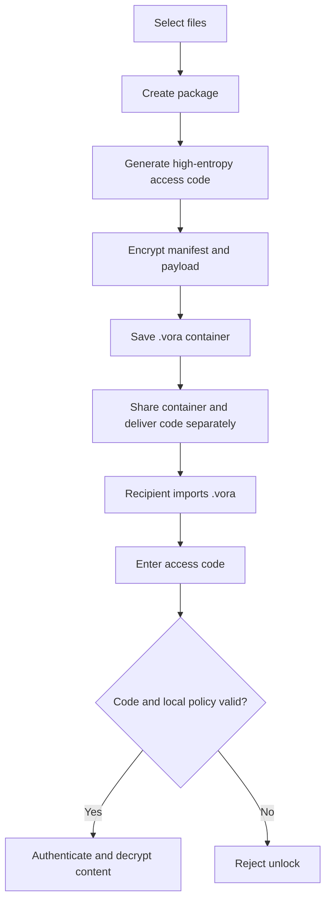
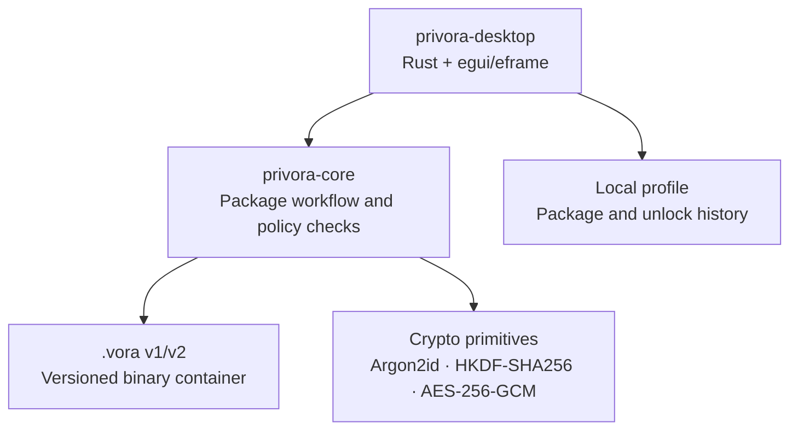

<div align="center">

# PRIVORA

### Share digital content without giving up control.

**An offline-first, Rust-native prototype for packaging files into encrypted `.vora` containers with local access policies.**

[](https://github.com/cactus-hd/Privora)
[](https://www.rust-lang.org/)
[](#platform-support)
[](LICENSE)

**[Architecture](#architecture) · [Security model](#security-model) · [Build](#build-from-source) · [Roadmap](#roadmap)**

</div>

> **Alpha software — not audited, not production-ready.** Privora is an engineering prototype for exploring encrypted file containers and offline access policies. Do not rely on it as a hardened DRM system or as the only protection for irreplaceable or highly sensitive data.

---

## Contents

- [What is Privora?](#what-is-privora)
- [Brand and product principles](#brand-and-product-principles)
- [Current features](#current-features)
- [Architecture](#architecture)
- [Repository structure](#repository-structure)
- [The `.vora` container](#the-vora-container)
- [Security model](#security-model)
- [Getting started](#getting-started)
- [Build from source](#build-from-source)
- [Windows installer](#windows-installer)
- [Android status](#android-status)
- [Testing and release checks](#testing-and-release-checks)
- [Roadmap](#roadmap)
- [Contributing and feedback](#contributing-and-feedback)
- [License](#license)

## What is Privora?

Privora explores a simple product idea: **share a file without casually giving up control over who can open it and when**.

The current prototype is a native desktop application written in Rust. It takes one or more files, packs them into a versioned `.vora` container, encrypts the container, and creates an access code that the recipient must provide to unlock the contents. A package can carry local policy metadata such as a validity window, a recipient label, an issuer note, and a best-effort local opening limit.

Privora is intentionally **not a cloud drive**. The current release is offline-first: package creation and unlocking do not require a Privora account or a Privora server. That simplicity is useful for testing the core workflow, but it also means some policies cannot be enforced globally across multiple people or devices.

### Core workflow



The access code should be delivered over a separate channel from the `.vora` file. Anyone who obtains both the package and its correct access code can decrypt it.

## Brand and product principles

**Product promise:** “Share digital content without giving up control.”

Privora's visual direction is calm, private, premium, and controlled — not an alarmist “hacker movie” aesthetic. The UI uses a dark base with restrained violet accents.

| Design token | Value |
|---|---|
| Accent violet | `#C478FF` |
| Background | `#0B0A0F` |
| Surface | `#141219` |
| Surface 2 | `#1C1821` |
| Primary text | `#F5F2F7` |
| Muted text | `#A7A0AE` |
| Border | `#2A2430` |

Design goals:

- Keep encryption and licensing understandable to non-cryptographers.
- Make the main workflow visible: create, protect, share, and unlock.
- Separate UI code from the file-format and cryptographic core.
- Prefer explicit security boundaries and honest limitations over absolute claims.
- Keep the first release small enough to test end-to-end.

The detailed UI direction is documented in [`docs/DESIGN_GUIDE.md`](docs/DESIGN_GUIDE.md).

## Current features

The current repository contains an **early desktop alpha** with these capabilities:

- Native desktop UI built with Rust and `egui`/`eframe`.
- Select multiple files and package file bytes without converting their content formats.
- Create encrypted `.vora` containers and display a high-entropy access code.
- Chunked AES-256-GCM payload encryption with authentication tags.
- Argon2id-based key derivation and HKDF-SHA256 separation of metadata and payload keys in `.vora` v2.
- Encrypted v2 manifest, including package identity, names, dates, recipient label, issuer note, policy limits, and file metadata.
- Local policy checks for a not-before date, expiry date, and maximum local openings.
- Import, authenticate, decrypt, and safely extract packaged files.
- Local package and unlock history, plus a Windows Inno Setup installer recipe.
- Automated core tests for round-trip encryption, multi-chunk payloads, wrong access codes, policy expiry, and manifest tampering.

See [`CHANGELOG.md`](CHANGELOG.md) for version notes and [`docs/RELEASE_CHECKLIST.md`](docs/RELEASE_CHECKLIST.md) for the checks expected before a release.

## Architecture

Privora is a Cargo workspace with a small number of deliberately separated components:



| Component | Responsibility |
|---|---|
| `apps/privora-desktop` | Native desktop entry point, views, local UI state, file pickers, and background work. |
| `crates/privora-core` | Package creation/inspection, access-code processing, encryption/decryption, policy evaluation, and safe extraction. |
| `packaging/windows` | Inno Setup configuration for a per-user Windows installer. |
| `scripts` | Build and test helper scripts for developers. |
| `docs` | Protocol notes, security model, UI direction, installer steps, platform status, and release checklist. |

The cryptographic core is a library rather than being embedded in widget callbacks. This allows it to be tested independently and provides a cleaner boundary for future platform clients.

## Repository structure

```text
Privora/
├── Cargo.toml
├── README.md
├── LICENSE
├── AGENTS.md
├── CHANGELOG.md
├── BUILD-FIX-NOTES.md
├── apps/
│   └── privora-desktop/
│       ├── Cargo.toml
│       └── src/
│           ├── main.rs       # Native application entry point
│           ├── app.rs        # egui screens and interactions
│           └── state.rs      # Local package/unlock history
├── crates/
│   └── privora-core/
│       ├── Cargo.toml
│       └── src/lib.rs        # Container format, crypto, policies, extraction
├── packaging/
│   └── windows/Privora.iss   # Inno Setup recipe
├── scripts/
│   ├── build-windows.ps1
│   ├── run.ps1
│   ├── test.ps1
│   └── build-linux.sh
└── docs/
    ├── ANDROID_BUILD.md
    ├── DESIGN_GUIDE.md
    ├── FORMAT.md
    ├── RELEASE_CHECKLIST.md
    ├── SECURITY_MODEL.md
    └── WINDOWS_INSTALLER.md
```

## The `.vora` container

The `.vora` format is a versioned application format. The current writer creates **v2** containers marked with `PRVORA02`; the reader also supports legacy v1 packages marked with `PRVORA01`.

### High-level v2 layout

| Field | Purpose | Visibility |
|---|---|---|
| Format marker | Identifies the container version | Public |
| Random KDF salt | Makes key derivation package-specific | Public; not a secret |
| Manifest nonce | Nonce for authenticated manifest encryption | Public |
| Encrypted manifest length | Lets the parser locate the payload | Public |
| Encrypted manifest | Package metadata and local policy | Encrypted and authenticated |
| Encrypted archive chunks | File contents, in authenticated chunks | Encrypted and authenticated |

### Cryptographic design in this prototype

- A random 32-byte access secret is shown as a Base32 access code.
- Argon2id derives a master key from the access secret and a random salt.
- HKDF-SHA256 derives separate keys for metadata and payload encryption.
- AES-256-GCM protects the v2 manifest and each payload chunk with authentication.
- Payload data is processed in 1 MiB chunks; each chunk has its own authentication tag and nonce derived from a random per-package prefix and a chunk index.
- The header and manifest are bound into authenticated data so that tampering is rejected.

This is the implemented v2 format, **not a finalized public standard or independently audited protocol**. Details and byte layout are in [`docs/FORMAT.md`](docs/FORMAT.md). Do not silently change nonce construction, KDF parameters, chunk sizing, or manifest semantics without defining a format version and compatibility plan.

## Security model

Privora aims to protect file contents while they remain inside a `.vora` container and to detect unauthorized changes to encrypted data. That is not the same as guaranteeing that an authorized recipient can never copy the plaintext.

### What the current design provides

- Confidentiality of v2 file content for someone who has the package but not the correct high-entropy access code.
- Authenticated encryption for the v2 manifest and content chunks.
- Metadata confidentiality for v2 manifest fields such as package name, dates, recipient label, issuer note, and local activation limit.
- Input length checks, extraction-path validation, bounded extraction, and rejection of malformed or tampered data.

### What it does not guarantee

- **No global activation counter:** the opening limit is stored locally and may be reset or bypassed by manipulating local state or using another installation.
- **No trusted clock:** expiry is compared with the device clock and can be affected by clock rollback.
- **No remote revocation or device binding:** this offline prototype has no server to enforce a global license state.
- **No protection after extraction:** decrypted files are ordinary files and can be copied, recorded, or redistributed by a recipient.
- **No secure-erasure guarantee:** the current workflow temporarily creates a plaintext ZIP on disk during creation and unlocking. Normal cleanup is not guaranteed secure erasure on SSDs, journaled file systems, or backups.
- **No audit yet:** the protocol and application have not undergone an independent security audit. Do not describe the system as “uncrackable.”

For complete details, read [`docs/SECURITY_MODEL.md`](docs/SECURITY_MODEL.md). Avoid using real sensitive files or live access codes in public bug reports.

## Getting started

### Requirements

- Rust stable and Cargo. The current project notes target Rust **1.95 or newer**.
- On Windows, the `x86_64-pc-windows-msvc` toolchain and Visual Studio Build Tools with **Desktop development with C++**, including an MSVC C++ build toolset and Windows SDK.
- Internet access for the first dependency download from crates.io. Once dependencies are cached, offline builds may be possible if all required crates are already available locally.

Verify the toolchain:

```powershell
rustc --version
cargo --version
rustc -vV
```

For a typical 64-bit Windows setup, `rustc -vV` should report a host like `x86_64-pc-windows-msvc`.

### Run the desktop app

From the repository root:

```powershell
cargo run --release -p privora-desktop
```

The first build can take time because Cargo downloads and compiles dependencies. If crates.io is temporarily unreachable, resolve the network issue and retry rather than changing application source code to address a download failure.

### Basic package workflow

1. Open **Create Package** and select one or more files.
2. Choose a package name and optional recipient label or issuer note.
3. Configure a start date, expiry date, and local opening limit if needed.
4. Create the encrypted `.vora` file and copy the displayed access code.
5. Deliver the `.vora` package and access code through separate channels.
6. On the receiving machine, select **Files / Unlock**, choose the package, enter the code, and select an extraction location.

Keep the access code safe. If it is lost, this version has no recovery service or backdoor.

## Build from source

Run these checks from the project root:

```powershell
cargo fmt --all
cargo fmt --all -- --check
cargo check --workspace
cargo test --workspace
cargo clippy --workspace --all-targets
```

Build the Windows executable:

```powershell
cargo build --release -p privora-desktop
```

Expected output:

```text
target\release\privora-desktop.exe
```

For Linux and macOS, build on the target operating system or set up an appropriate cross-compilation toolchain. A Windows `.exe` does not become an Android APK or macOS application by renaming it.

## Windows installer

The repository includes an Inno Setup script that can package the Windows release executable into a per-user `Setup.exe` installer.

1. Install [Inno Setup 6](https://jrsoftware.org/isinfo.php).
2. From the repository root, run:

   ```powershell
   .\scripts\build-windows.ps1 -Installer -Test
   ```

3. The expected result is `dist\Privora-Setup-0.3.0-x64.exe`.

This script creates a **Setup.exe**, not an MSI. If a managed-deployment MSI is required later, the packaging approach can be changed to WiX and validated separately. Full steps are in [`docs/WINDOWS_INSTALLER.md`](docs/WINDOWS_INSTALLER.md).

## Android status

**The current repository is not yet ready to produce a usable Android APK.** The core is written in Rust, but the current desktop app uses native desktop file dialogs and does not yet include the complete Android launcher/Gradle project or Storage Access Framework integration.

A real Android port needs an Android entry point, appropriate Cargo/NDK target configuration, packaging and signing, and an Android document-picker bridge. These pieces must be implemented and tested on a device or emulator; adding a Rust target alone is not sufficient. See [`docs/ANDROID_BUILD.md`](docs/ANDROID_BUILD.md).

## Testing and release checks

Before creating a release, use [`docs/RELEASE_CHECKLIST.md`](docs/RELEASE_CHECKLIST.md). At minimum:

- Run formatting, workspace checks, all tests, and Clippy.
- Test text, image, audio, and large video files end to end; compare hashes before and after unlocking.
- Test wrong codes, altered metadata, corrupted chunks, expired packages, and future start dates.
- Verify that a newly created v2 container does not expose confidential manifest fields in plaintext.
- Verify behavior on clean Windows installations and with multiple window sizes.
- Review temporary-file and local-history behavior.
- Get an independent security review before production or high-sensitivity use.

## Roadmap

The roadmap is ordered by technical risk, not marketing priority:

1. **Stabilize the alpha:** reproducible builds, test coverage, UI quality, and consistent error handling.
2. **Harden the container:** fuzz parsing and extraction, test malformed lengths and tampering, review temporary-file handling, and freeze the v2 format specification.
3. **Improve local license semantics:** clearer start/expiry behavior, documented limits, and tests around policy boundaries.
4. **Prepare Android:** native app entry point, document picker/SAF integration, packaging, and device-level tests.
5. **Evaluate stronger licensing architecture:** signed license objects, recipient/device identity, and an optional online authority if global activation counts or revocation become requirements.
6. **Production review:** external protocol and application security assessment before making strong security claims.

No roadmap item should be read as already implemented unless it is listed in [Current features](#current-features) and verified in the code.

## Contributing and feedback

This project is currently in alpha and its custom license restricts commercial use and redistribution. Bug reports and thoughtful technical feedback are welcome. Please:

- Include the version, operating system, and relevant sanitized logs.
- Never upload private `.vora` files, plaintext source content, passwords, or access codes to a public issue.
- For security findings, avoid posting exploit details or sensitive package samples publicly; use a private contact path where available.

Issues: <https://github.com/cactus-hd/Privora/issues>

## License

Privora is **source-available, not OSI-approved open-source software**. The custom [Privora Personal Learning and Non-Commercial License](LICENSE) allows private personal use, educational study, and non-commercial experimentation while restricting commercial use and redistribution. Read the complete terms before using the source or binaries.

If you need to prevent the public from viewing or forking the source, keep the repository private. GitHub's own Terms of Service govern public repository viewing and platform-hosted forks; a custom license cannot turn a public repository into a private one.

---

## Support the project

If Privora helps you with your work or it was helpful for learning somthings, starring the repository is a simple way to support the project ⭐ .
 

<div align="center">

**PRIVORA** · Create · Encrypt · License · Share

</div>
